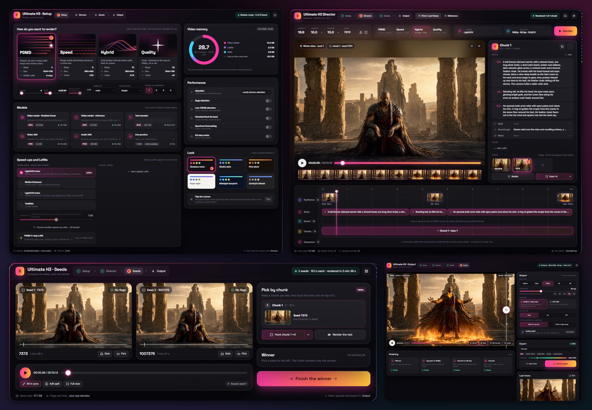

# Stubelius Ultimate H3

[](https://youtu.be/Xeyb0Y9bvho)

**▶ [Watch the 0.13 video on YouTube](https://youtu.be/Xeyb0Y9bvho)** (22 min). It goes through all four windows, from
the first setting to the finished video, with hunting and retaking one chunk, middle frames and characters from many
pictures.

One MiniMax H3 workflow for ComfyUI, in four windows. **Setup** decides **how** the video is made
(Speed, Hybrid, Quality or PDMD, the models, the speed-ups). The **Director** holds **what the
video is**. **Seeds** plays 1–4 full seeds with sound side by side, you pick the winner, and only
the winner gets finished in **Output** (resolution, frame rate, upscaler).



The workflow is in [`example_workflows/Stubelius_Ultimate_H3.json`](example_workflows/Stubelius_Ultimate_H3.json).
Once the pack is installed it also appears in ComfyUI under **Workflow → Browse Templates → Stubelius-Ultimate-H3**.

## What's new in 0.15

- **FastH3 Omni mode**: FastVideo's (Hao AI Lab and Nuva Lab) 8-step distilled Reference model, with its sparse
  attention built in. Reference mode only; every chunk renders on it, so a voice clip reaches every chunk
  ([FastH3 Omni mode](#fasth3-omni-mode)).

## What's new in 0.14

- **Flow shift** in the Setup window (video and audio): render on the shift a speed-up LoRA or checkpoint was
  trained on, for example 6 / 3 for LightX2V's 768p turbo LoRAs ([Flow shift](#flow-shift)).

## What's new in 0.13

Video walkthrough: [Ultimate H3 0.13 on YouTube](https://youtu.be/Xeyb0Y9bvho)

- **Four windows**: Setup, Director, Seeds and Output, six looks, a **How to use** window, and a short explanation
  when you hover over an option.
- **Hunt one chunk**: render a later chunk with 2, 3 or 4 seeds of its own instead of the whole video, then pick it
  in Seeds. **Retake** renders a chunk again with its own seed; the chunks before it stay, and every take is kept to
  pick back ([Takes](#takes-render-one-chunk-again)).
- **How a chunk joins the one before it**: picture and sound, the picture with fresh sound, the last frame only, or a
  **new shot** ([Videos past one chunk](#videos-past-one-chunk)).
- **Characters from many pictures** (RefMods): make one from 8 to 16 pictures and put it on every chunk
  ([Characters](#characters-from-many-pictures)).
- **Output**: any frame rate from 24 to 120, the finished video against the winner in a split view with a loupe, and
  a Last frame card.

Already on an older version? [Update](#update) in place, then open the example workflow to get the windows.

## The four windows

The example lays them out left to right, each in its group. The step bar at the top of every window
jumps to the others. On the left, the **How to use** window (Stubelius H3 Guide, in the windows' look)
walks through all four; its text ships with the pack (`js/how_to_use.md`), so it updates with the nodes.
A workflow with the older How to use note gets the window in its place once, when it opens.

| Window | Node | What it holds |
|---|---|---|
| **1 Setup** | Stubelius H3 Setup | The five modes: Speed (≈480p, 8 steps), Hybrid (≈540p, 10 steps), Quality (≈768p, 20 steps, no speedup LoRA), PDMD (≈768p in 4 steps), FastH3 Omni (≈768p in 8 steps on its own checkpoint, Reference mode only), and their fine-tuning, the flow shift included; how many seeds to compare (1–4); the models (from the Models node, each with its precision, its size and whether it's on disk); the turbo, PDMD and two global LoRAs (strength −9 to 9, for slider LoRAs); attention and low-VRAM switches; the video memory; the look of every window (six themes) |
| **2 Director** | Stubelius H3 Director V2 | Reference (Omni) or First/Last Frame mode, shape, length (Extend past one chunk), chunk size, seed, **Render**. A preview of the takes, an inspector for the chunk you pick (how it joins the chunk before it, its shots, style, sound, music, **LoRAs per chunk**, its **takes**), a timeline (keyframes with up to eight **middle frames** or a **clip to continue**, shots, **sounds and clips** pinned at a second, chunks, **characters** made from many pictures) and, in Reference mode, the cast and reference clips |
| **3 Seeds** | Stubelius Seed Previews | Every seed side by side and in sync, with the Output's de-stutter, as the finished video will move. Solo a seed's sound, an A/B split, loop a chunk. Hints where a take may need a look (held frames redrawn, a nearly silent take), never a ranking. **Pick** the winner, or pick chunk by chunk |
| **4 Output** | Stubelius H3 Finish | The winner against the finished video (a divider to drag, a 2× loupe), the finish step by step, the Output node's settings: final resolution per mode (Speed up to 2K, the other modes up to 4K; exact short side, portrait too), any frame rate from 24 to 120 (above 24 RIFE draws the in-between frames), RTX VSR or DLSS5 + Color Lock, Quality polish (1.5x or 2x), **de-stutter**, a continued clip in front of the video or not. Then the saved file with its loudness, **Open folder**, and the latest results. A change here re-runs only the finish, from cache |

Behind the windows, collapsed: **Stubelius H3 Models** and **Stubelius H3 Output** (the windows edit
them), **Stubelius Theme**, **Stubelius Live Preview** (watch the Director and the Quality polish
while they sample; the Director's preview shows it too), the prompt override (any text there
replaces the timeline's prompts), the compiled prompt and the final save. Their wires aren't drawn
while they're behind a window: move a window to reach them. **Stubelius RIFE to FPS** and
**Stubelius Color Lock** convert the frame rate (keeping hard cuts clean) and restore the original
colours after DLSS5.

Each window sits on its step's panel, drawn in the workflow theme's colours and fitted to the window
as it grows; the panel's title row moves the step around. A workflow laid out before (the helper
nodes under the windows) is tidied once when it opens: the helpers go behind the windows and the
panels fit them. **Tidy the canvas** under Look in the Setup window does it again any time.

**Render, pick, finish.** **Render** in the Director renders the seeds and stops: pick one in Seeds,
then **Finish the winner** (or **Finish** in Output). A new Render drops the old pick, since the
seeds are new. With one seed, **After a render with one seed → Finish it right away** in Output
goes straight on to the finish. The Finish node's **winner** is what the windows set: 0 holds after
the seeds.

**Seed Previews** is an output node: it saves an mp4 per seed in ComfyUI's output folder under
`StubeliusH3/previews` (overwritten by the next render of the same Director).

**Workflows from before the windows** keep the Setup, Seed Previews and Finish nodes as they were,
with a **Show as window** button on each; the Director is a window everywhere. ComfyUI's own Queue
button works as before. The windows' fonts (Inter, Space Grotesk, JetBrains Mono) ship with the pack,
so the windows look the same offline and ask no other server for anything.

## Videos past one chunk

A video longer than one chunk is rendered chunk by chunk (Extend). Four things hold across the chunks.

**How a chunk joins the one before it.** Every chunk after the first has a **How it joins** setting
at the top of its inspector in the Director; the badge between two chunks on the timeline sets it
too. The first chunk has it too when the video continues a clip.

- **Picture + sound** (the default): the last 1.6 s of the chunk before, picture and sound,
  run on into this one unchanged. The smoothest join.
- **Picture, fresh sound**: the picture runs on and the sound is made fresh. Use it when a
  later chunk sounds dull or muffled: in tests the carried sound lost voices and breathing, and made
  fresh they stayed clear.
- **Last frame only**: nothing is carried over; the chunk starts from the last frame of the one
  before. In PDMD this halved the drift towards a darker, more detailed, more saturated look in
  later chunks. Motion runs on through the join less smoothly.
- **New shot**: a cut, with nothing carried over, no last frame and no smoothing at the join. A
  middle frame placed in the chunk's first half second opens the new shot. That is how to cut to a
  picture from another shot, which H3 otherwise jumps to early and then holds.

The Quality polish follows each chunk's setting.

**Lip Sync from a recording.** Set a reference audio to **Lip Sync** and the recording is the
video's sound. Every chunk is rendered against its own part of the recording, so the lips follow
it for the whole video, and the finished video plays the recording itself.

- The final sound is the recording and nothing else: no ambience or music is generated under it.
- Where the recording is over, the video is silent and the character stops talking. A later chunk
  that has a quoted line of its own in its shots is spoken by the model instead.
- **Transcribe** → **Insert as timed shots** (under the Lip Sync recording in the cast) gives each
  chunk its words with their real timings. A chunk without typed lines still follows the recording.
- A video comes out a little longer than the duration asked for, because every chunk snaps to the
  model's frame grid (a 30 s video in 10 s chunks is 31.4 s). A recording as long as the video
  therefore ends just before it does.
- Needs a current ComfyUI (developed on 0.37). On a ComfyUI whose MiniMax H3 model cannot hold the
  audio still, the log says so and the recording is used as a reference, as before.

**A chunk with nothing to say stays quiet.** Without a recording, a chunk that continues a talking
shot and has no quoted line in its shots is told that nobody speaks. Quote a line, or describe a
voice in a shot (she sings, the crowd cheers, heavy breathing), and it is left alone. A talking
shot is one with a quoted line or words like *says* or *whispers* in an earlier chunk, or the clip
the video continues. In a video where nobody talks, no chunk is told this, so breathing and other
voice sounds carry on into the next chunk.

**Quality polish.** Quality at 1080p and up renders the take again, bigger, and the upscaler
takes it the rest of the way to 2K or 4K. **Scale** under Quality polish in the Output window sets
how much bigger: 1.5x (the default) or 2x. Every chunk is polished with the checkpoint that made it
and joined as the Director joined the originals. The polished video has the same length and the
same sound as the take it came from.

- **1.5x** renders about 1152p from the Quality preset, enough for 1080p. It uses zhangccccc's
  H3 latent upscaler, which builds the 1.5x latent directly
  ([nodes](https://github.com/LBH-123-AI/Comfyui_Minimax_h3_latent_Upscaler),
  [model](https://huggingface.co/zhangccccc/Minimax_h3_latent_Upscaler)). Without it the polish
  runs at 2x and the log says so. On an RTX 5090 at the Quality preset a 1.5x step takes 38 s for
  a 6.6 s chunk (106 s at 2x), 77 s for a 10 s chunk and 110 s for a 10 s chunk that continues a
  video.
- **2x** renders about 1536p. Use it for a take rendered smaller than the Quality preset, or to
  polish 2K itself. It is heavy: on a 32 GB card at the Quality preset it fits chunks up to 8 s,
  or 10 s for a video's first chunk (one that continues a video also re-renders the frames it
  carries over). A longer chunk spills out of the card and takes hours. A 2x step takes 2 to 4
  minutes.

The polish runs 12 steps by default. A large polish turns on KJNodes' low-VRAM patches
by itself (ComfyUI-KJNodes 1.5.1 or newer); they give the same picture. The polished video ends up
in memory uncompressed: about 11 GB for every 10 s at 2x from the Quality preset, about 6 GB at
1.5x. Long takes need a lot of RAM.

## Takes: render one chunk again

Every chunk the Director renders is kept as a take. A take is found by what made it: the chunk's
prompt, pictures, sounds, settings, models and LoRAs, its seed and, when it starts from the chunk
before it, that chunk's take. When a chunk would come out the same, its take is loaded instead and
nothing is sampled.

In the Director, pick a chunk (on the timeline, or with the arrows in its inspector):

- **Retake** gives the chunk a new seed of its own and renders the video up to it. The chunks before
  it come from their takes; the chunks after it render again with the next **Render**.
- **Takes**, under it, are that chunk's kept takes. Point at one to play it in the preview; click it
  to pick it back (its seed again). It is loaded, and so are the chunks after it that were rendered
  after it. **back to the Director's seed** drops the chunk's own seed.
- **Hunt**: 2, 3 or 4 candidates (the arrow beside the button picks how many, the button repeats it)
  that differ in that chunk alone, each the video up to it. The chunks before it render once. Pick one
  in Seeds (**Pick by chunk**): its seed becomes the chunk's own. Then hunt the next chunk on top of
  it (the Hunt there has the same arrow and the same count), or **Render the rest**.
- **Seeds to compare** in Setup with every chunk on its own seed (after picks): the first seed is the
  video as picked and the others try new seeds for the last chunk, so each seed is a different video.
- **Render to chunk N** (next to Render, with a chunk before the last picked) works on the start of
  a long video first. The Finish waits for the whole video.
- **Stop** keeps the chunks it finished: the next Render picks up where it stopped.
- **Takes kept** at the bottom of the Director shows the folder's size; click it to clear every take.
- A **new shot** in First/Last Frame mode doesn't start from the chunk before it, so retaking that
  chunk keeps the new shot. In Reference mode a new shot still hears the end of the chunk before it,
  so it renders again.
- Candidates share the chunks that have a seed of their own and vary the rest, as seeds always did.

By default every chunk renders with the Director's seed: a different seed at a join can change the
fine grain from one chunk to the next. If a retake shows that at its join, retake it again or pick
the take before.

Takes need the Models node (with plain model sockets nothing is kept on disk). They live in
ComfyUI's output folder under `StubeliusH3/takes`, roughly 60-120 MB for a 10 s chunk. The folder
holds at most 20 GB, and the takes used longest ago are removed first; set `STUBELIUS_TAKES_GB` to
change that (0 keeps none). The frames are kept lossless at 8 bits a channel, so a loaded take
matches the render to the last 8-bit step, and its sound is the same to the sample. Only the two frames
blended at a join are drawn again from the stored frames, a few levels off at most.

Measured on an RTX 5090: a 12 s video in two Speed chunks took 121 s to render and 6.5 s from its
takes; retaking its second chunk took 54 s.

For scripts, in `timeline_data`: `takes_id` (keep takes on disk and report them for this node),
`chunks[i].seed`, `render_until` (a chunk index from 0) and `hunt_chunk` (`{"chunk": i, "count": 4}`).

## Middle frames

In **First/Last Frame** mode the video can pass through up to eight **middle frames** on its way from
the first frame to the last.

- Drop pictures on the **Keyframes** lane of the Director's timeline, where they land at that second,
  or click **+** on the lane to add one at the playhead. Drag a middle frame along the lane to change
  when the video reaches it; click it for another picture, to type its second, or to remove it. A
  picture dropped on a middle frame swaps the picture and keeps its time.
- Middle frames stay half a second apart, and half a second from the first and the last frame. A
  shot's edge dragged close to one snaps onto it, so a shot can run from one frame to the next.
- Each middle frame is pinned on its own frame with ComfyUI's **Add Guide for MiniMax H3**, as in
  ComfyUI's own multiframe template. The text encoder sees the first and the last frame, as before,
  so describe what happens on the way in the prompt.
- In a video longer than one chunk, a middle frame belongs to the chunk that renders that second.
  The Quality polish follows the take through the middle frames.
- **How many.** Each middle frame adds a little render time: eight add about a tenth. In tests every
  one landed on its own frame, also when the pictures were moved to other times than in the take
  they came from. The video follows the pictures more closely the more there are, up to about one
  every half second.
- **Fast action at the start of a chunk.** A middle frame on fast action (something racing through
  the picture) in the first half second of a chunk that continues the video can snap into place for
  one frame. Pin the moments just before and after it instead. Anywhere else, fast action pins cleanly.

## Continue a clip

In **First/Last Frame** mode the first frame on the Keyframes lane also takes a video. Drop a clip
there (or click **First frame** and pick one) and the new video starts where the clip ends: the clip's last 1.6 s of picture and sound are carried in, the
same way each chunk of a long video continues the one before it, so the motion and the sound go on
without a cut.

- The video is rendered at the clip's shape; the aspect ratio setting doesn't apply.
- The timeline and the total duration are the new part. Middle frames and a Last Frame work as
  usual, so a clip can be continued to a picture of your choice.
- **The clip it continues** in the Output window (Clip + new part, or New part only) puts the clip in
  front of the new part, as one video (its own frames, only resized), or leaves it out, to place the
  new part after the clip in an editor. Changing it re-runs only the finish.
- A clip at another frame rate is read on H3's 24 fps clock, a clip without sound is continued in
  silence, and a phone clip is turned upright.
- The Quality polish starts from the clip's frames too, so the motion runs on smoothly at the
  polished size. The clip itself is only resized (with the Output's upscaler), so from the join on
  the polished part shows more fine detail. For an even look, continue a clip at its own size, in
  the mode it was made in.

## Sounds and clips on the timeline

In **First/Last Frame** mode the **Sound** lane of the Director's timeline takes sounds and short
video clips. Drop one on it, or click **+** on the lane to pin one at the playhead, and it is pinned
at that second with ComfyUI's **Add Guide for MiniMax H3**: the video is made around it.

- **A sound** (a spoken line, a sound effect, music) plays from that second as it is. For a line,
  type the same words in the shot, in quotes, at that moment: the recording gives the words and the
  shot tells H3 that someone is talking. Without the words in the shot the lips may not follow. In our
  tests every word landed within about 40 ms of its pin and the lips followed. A sound doesn't move the
  picture on its own, though: H3 still times the action from the shot's words. For a reaction right on
  the sound, pin a middle frame of it just after (a door slam at 3.0 s, a frame of her looking back at
  3.3 s).
- **A clip** plays its own frames from that second, and its own sound unless the speaker on it is
  off. It is pinned for as many frames as H3's clip lengths allow (5, 22, 39, 56 ... frames), starts
  on H3's 17-frame grid (every 0.71 s, the lane snaps it there: between two grid points its frames
  come out grey) and stays inside its chunk. The speaker icon on a clip's block turns its sound off.
- Drag a block to move it, × removes it; up to 8. A sound may run on into the next chunk.
- The Quality polish doesn't pin them again: the take already plays them.

## Characters from many pictures

A character can be made from many pictures of it, saved once and given to every chunk of a video. The
**Characters** lane at the bottom of the Director's timeline holds them, in both modes.

- **+ → Make a character from pictures**: drop 8 to 16 pictures of one character (the face from
  different angles and in different light, nothing else in focus), name it and say in words how it
  looks. **Make** encodes the pictures with H3's video VAE (a few seconds, after a render in progress)
  and saves the character in the `refmods` folder (ComfyUI-MiniMaxH3Mod's, when that pack is installed, else
  `models/refmods` next to your `loras` folder), with a contact sheet of its pictures. **+ → Add a saved
  character** picks one from that folder; the library shows where it is.
- Click a character for its **strength** (below 100% its pictures are blurred, not hidden: a looser
  likeness), to switch it off, or to remove it. **Add it to chunk N's first shot** types its
  description into that shot: H3's text side never sees the pictures, so say who it is in words too.
- **What it does.** The pictures ride H3's own reference path, the one a Reference (Omni) picture
  takes, in every chunk and in both modes. In First/Last Frame mode, where H3 otherwise has only the
  first and last frame and the words, a character holds the face that words alone don't. In Reference
  (Omni) mode it adds to the cast. The cast goes into the first chunk only (later chunks continue from
  the frames before them) and the character into every chunk, but in the tests below one good picture
  in the cast did as well in one chunk and nearly as well past the join, and both together didn't add
  more.
- **What it costs.** Each picture adds reference tokens to every sampling step: about 500 at 0.5 MP
  (the default) and 1,000 at 1 MP. Eight pictures made a 6 s Hybrid chunk about 15 % slower at 0.5 MP
  (7 to 8 s) and 28 to 33 % slower at 1 MP (14 to 18 s), and a PDMD chunk at 1 MP 13 % slower (render
  time, medians on an RTX 5090). 0.5 MP held the face as well as 1 MP, and better past the join.

In tests (one character from 8 pictures, a scene none of them show, a 6 s Hybrid take on each of three
seeds; the [RefMods video](https://youtu.be/oO6WgxdFJOY) shows them) each take was scored with face
recognition against other footage of the character (1.0 = the same face; the character's own footage
scores 0.85 by this measure). A score is each take's median over its frames, averaged over the seeds:

| | Score |
|---|---|
| Reference (Omni), words only | 0.34 |
| Reference (Omni), one design picture in the cast | 0.77 |
| Reference (Omni), one of the 8 pictures alone in the cast | 0.69 |
| Reference (Omni), a character (8 pictures, 0.5 MP) | 0.77 |
| Reference (Omni), a character (8 pictures, 1 MP) | 0.76 |
| Reference (Omni), a design picture + a character (1 MP) | 0.73 |
| First/Last Frame, words only | 0.23 |
| First/Last Frame, a character (1 MP) | 0.80 |

**Past one chunk.** 12 s in two 6 s chunks in First/Last Frame mode, the character described in words
in the first chunk only (the second chunk's shot just says "he"), three seeds per row:

| | Chunk 1 | Chunk 2 | Render (12 s) |
|---|---|---|---|
| Hybrid, words only | 0.25 | 0.25 | 113 s |
| Hybrid, a character (0.5 MP) | 0.81 | 0.75 | 130 s |
| Hybrid, a character (1 MP) | 0.77 | 0.70 | 149 s |
| PDMD, words only | 0.28 | 0.27 | 145 s |
| PDMD, a character (1 MP) | 0.77 | 0.76 | 164 s |

The character holds the face through the join: with it (0.5 MP) every seed's second chunk scored 0.66
to 0.80, with words alone 0.16 to 0.33. 18 s in three chunks (Hybrid): words alone 0.25, 0.25 and 0.23,
the character (0.5 MP) 0.81, 0.75 and 0.75. The spoken line came out word for word in all 30 takes with
a character (23 of 24 without).

In Reference (Omni) mode, 12 s in two chunks set up the same way (Hybrid, the character at 0.5 MP), one
design picture in the cast scored 0.74 and 0.74 (140 s), the character 0.76 and 0.76 (167 s), both together 0.67 and
0.74 (180 s): the second chunk continues from the first one's frames, and those carried the cast
picture's face as well.

The files are [ComfyUI-MiniMaxH3Mod](https://github.com/Luisacaotica/ComfyUI-MiniMaxH3Mod)'s RefMods:
ones made with that pack load here, and the other way round. Tuned RefMods (made with shootthesound's
Fizgig) are tuned for one checkpoint; use them in the mode they were made for. For scripts, in `timeline_data`:
`refmods` (`[{"file": "<name in models/refmods, or a path>", "strength": 1.0}]`, `"enabled": false`
leaves one out); the node **Stubelius H3 Make a Character (RefMod)** makes one from pictures in the
input folder.

## Voices: a recorded line, a voice sample, Lip Sync

| You have | Where it goes | What the character says |
|---|---|---|
| A recording of the exact line | First/Last Frame mode: the Sound lane, at its second (type the words in the shot too). Or Reference (Omni) mode: a reference audio set to **Lip Sync: this exact recording**, for the whole video's sound | The recording, word for word |
| A voice sample and new words | Reference (Omni) mode: the sample in **Ref Audio N** (Reference audio, under the cast) for the character in **Ref N**, set to **Voice reference: new lines, same voice**; type the new line in the shot | The shot's words, in a voice like the sample's |
| A voice sample, and the voice has to match closely | Make the line first with a voice-clone TTS (for example the LongCat AudioDiT, Fish Audio S2 or VoxCPM2 nodes), then use it as a recording (first row) | The cloned line |

- **Voice Reference reaches the first chunk only** (except in [FastH3 Omni mode](#fasth3-omni-mode), where
  every chunk renders on the Reference model). Past one chunk, a Reference (Omni) video continues on
  the First/Last Frame checkpoint (hybrid continuation, switched on by itself), which takes no audio; the
  later chunks carry the voice on from the last 1.6 s of the chunk before, not from the sample. For longer
  dialogue, clone the lines and use Lip Sync, which reaches every chunk.
- **Lip Sync or a line on the Sound lane.** Lip Sync makes the recording the video's whole sound: every
  chunk follows it and the finished video plays the file itself, with nothing generated under it.
  **Transcribe → Insert as timed shots** types its words into the shots. A line on the Sound lane is one
  sound at its second, in a video whose other sound H3 makes.

## De-stutter

Some takes judder: the picture holds still for a frame in a steady rhythm while the rest moves, "move, move,
hold" (every third frame almost a copy of the one before, like 16 fps footage stretched to 24) or "move,
hold". It shows most in Speed mode: a 15 s Speed take measured 95 held frames, one every 3 frames, where PDMD
on the same seed had none. RIFE to a higher frame rate doesn't fix it; it only splits each jump.

**De-stutter** in the Output window finds the held frames and RIFE draws them again on the way to the next pose,
so the motion runs evenly. A held picture is one pose shown twice: it is placed halfway between its two frames
and both are drawn again. Every other frame stays as it was rendered, the length and the sound stay as they
were, and nothing is drawn across a hard cut.

- **auto** (the default) acts only on takes that judder (held frames on at least 8% of the moving steps);
  **on** takes every held frame it finds; **off** never.
- The Seeds window plays the seeds with it too, so the seed you pick looks the way it will in the finished
  video. Changing the switch re-runs only the previews and the Finish, never the seeds.
- On the Speed take above: roughness (how unevenly the picture moves from frame to frame) 0.83 before, 0.23
  after, against 0.27 for PDMD.

## Jagged or smeared motion

- **Judder** (a held frame every second or third frame): Speed mode's takes do it most. **de-stutter**
  (above, auto by default) fixes the rhythm, and PDMD renders much smoother in the first place. A higher frame rate
  alone doesn't fix it.
- **Fast, small motion smears** (fingers, hands): render in PDMD instead of Speed. At Speed's ≈480p a
  finger is a few pixels wide; PDMD renders ≈768p in 4 steps and fixes most of it.
- **Jerky after pinning a line**, things to check: the shot has the line's exact words and keeps the action
  light while the character speaks; the line stays inside one chunk; the recording has no hard cuts, long
  pauses or clipping (short fades, peaks around -3 dBFS). And try two or three seeds: any pin changes the
  whole take, so the same seed with a pin is a different take.

## PDMD mode

**PDMD** renders at the Quality size (≈768p) in 4 steps, with the 4-step LoRA from
[PDMD](https://pdmd2026.github.io/) (Projected Distribution Matching Distillation, Apache-2.0), and the
Output upscaler takes it to 1080p, 2K or 4K. There is no polish in this mode.

Put PDMD's LoRA in `models/loras` as it is published: `lora_model_0.safetensors` from
[pdmd2026/pdmd_4NFE_lora](https://huggingface.co/pdmd2026/pdmd_4NFE_lora) (1.4 GB), under any name,
for example `pdmd_4nfe_lora.safetensors`. Pick it as the **PDMD 4-step LoRA** in the Setup window; in
PDMD mode it takes the place of the speedup LoRA. The file uses Diffusers' names for H3's layers, which ComfyUI's
LoRA loader doesn't know, so the pack converts it when it loads it (any H3 LoRA saved that way works in
the LoRA slots now).

Measured on an RTX 5090, 6.6 s clips at 1344x768 finished to 2K with DLSS5 + Color Lock: PDMD 100 s
(67 s of it the 4-step render), Hybrid 85-99 s (at half the pixels), Quality with its 1.5x polish
715-800 s.

## FastH3 Omni mode

**FastH3 Omni** renders on [FastH3 Omni](https://huggingface.co/FastVideo/FastH3-Omni-Comfy), FastVideo's (Hao AI Lab and
Nuva Lab) MiniMax H3 Reference model distilled to 8 steps: a checkpoint of its own, so no speedup LoRA goes on top.
It renders at the Quality size (≈768p), and the Output upscaler takes it to 1080p, 2K or 4K. There is no polish in
this mode.

- **Reference mode only.** FastH3 Omni has no first or last frame, so the Director tells you to switch to Reference
  (or pick another mode for First/Last Frame).
- **Every chunk renders on it.** Past one chunk the video continues in Reference mode, from the last frame and the
  sound of the chunk before, instead of switching to the First/Last model. So a voice clip reaches every chunk:
  in 24 s videos made of two chunks (3 seeds), the second chunk's voice matched the clip at 0.88, against 0.75 in
  PDMD mode, whose later chunks run on the First/Last model, which takes no voice clip.
- **Its sparse attention is built in.** The checkpoint is trained with VSA (video sparse attention, 10 %), which its
  template says it must run with; the mode applies it the same way. Sage attention, low-VRAM attention and chunked
  feed-forward replace the attention it sits in, so this mode leaves them out.
- **Setup:** download `fasth3_omniref_8step_pruned_int8_convrot.safetensors` (22.2 GB) from
  [FastVideo/FastH3-Omni-Comfy](https://huggingface.co/FastVideo/FastH3-Omni-Comfy) into `models/diffusion_models` and
  pick it as the **FastH3 Omni** model in the Setup window. It needs ComfyUI 0.42 or newer.

Measured on an RTX 5090 against PDMD in Reference mode (1344x768, 8 shots, 3 seeds each, the same prompts, pictures
and seeds): about 1.3x PDMD's render time for a 5 s clip, about the same
at 10 s, and about 10 % faster at 15 s. Every line was spoken word for word in both (30 of 30). PDMD kept a
character's face a little closer (face match 0.74 against 0.71); a voice clip was followed as closely (0.94 and
0.95). FastH3 Omni held still frames (a stutter) in 2 of 21 takes, PDMD in 8, most of all in fast motion. Without
its sparse attention the same clips took about 1.8x PDMD's time.

## Flow shift

**Video shift** and **Audio shift**, under the fine-tuning in the Setup window, decide where the sampler spends its
steps: a higher shift spends more of them on the rough shapes and motion, a lower one more on the fine detail.
H3's own is 12 / 3, and every mode starts there: picking a mode puts it back.

Render on the shift a speed-up LoRA or checkpoint was trained on. LightX2V's 768p turbo LoRAs were trained on 6 / 3;
its 544p turbo LoRAs, PDMD's 4 steps and FastH3 Omni on 12 / 3. When the turbo LoRA in use is one of LightX2V's, the window says
which shift it was trained on and offers it in one click.

- A take made on another shift is a new take: the ones made before stay in Takes.
- The Quality polish runs on the shift the take was made on.
- For scripts: the Setup node's `shift_video` and `shift_audio` inputs (optional; 12 and 3 when left out).

## Install

Needs ComfyUI 0.34 or newer (made and tested on 0.41, frontend 1.55): update ComfyUI first.

**ComfyUI Manager:** Install via Git URL → `https://github.com/stuubszzz/Stubelius-Ultimate-H3`, then restart.

**git:**

```bash
cd ComfyUI/custom_nodes
git clone https://github.com/stuubszzz/Stubelius-Ultimate-H3
```

Windows portable, from the `ComfyUI_windows_portable` folder:

```bash
python_embeded\python.exe -m pip install -r ComfyUI\custom_nodes\Stubelius-Ultimate-H3\requirements.txt
```

## Update

Manager → **Update All**, or `git pull` in `custom_nodes/Stubelius-Ultimate-H3`, then restart ComfyUI.
Each update brings the newest nodes and the newest example workflow.

## Other node packs

Load the workflow and use Manager → **Install Missing Custom Nodes**, or install them yourself:

| Pack | Needed for |
|---|---|
| [ComfyUI-VideoHelperSuite](https://github.com/Kosinkadink/ComfyUI-VideoHelperSuite) | video outputs |
| [Nvidia RTX nodes](https://github.com/Comfy-Org/Nvidia_RTX_Nodes_ComfyUI) | RTX VSR upscaling (NVIDIA RTX GPU) |
| [ComfyUI-KJNodes](https://github.com/kijai/ComfyUI-KJNodes) | live preview, low-VRAM options, a large Quality polish |
| [ComfyUI-Frame-Interpolation](https://github.com/Fannovel16/ComfyUI-Frame-Interpolation) | frame rates above 24 |
| [ComfyUI-H3-Motion-Context-MultiRef](https://github.com/seitanism/ComfyUI-H3-Motion-Context-MultiRef) | recommended: smoother continuity past one chunk |
| [ComfyUI-MiniMaxH3_LatentUpscaler](https://github.com/Tr1dae/ComfyUI-MiniMaxH3_LatentUpscaler) + [ComfyUI-H3-Latent-Upscaler-Mamad8](https://github.com/mamad8c/ComfyUI-H3-Latent-Upscaler-Mamad8) | Quality polish at 2x ("learned model (2x)") |
| [Comfyui_Minimax_h3_latent_Upscaler](https://github.com/LBH-123-AI/Comfyui_Minimax_h3_latent_Upscaler) | Quality polish at 1.5x (zhangccccc's H3 latent upscaler, model below) |
| [ComfyUI-DLSS5-Enhancer](https://github.com/Blueforcer/ComfyUI-DLSS5-Enhancer) | DLSS5 upscaler |
| [ComfyUI-GGUF](https://github.com/city96/ComfyUI-GGUF) | GGUF models |
| [ComfyUI-Spectrum-MiniMax-H3](https://github.com/xmarre/ComfyUI-Spectrum-MiniMax-H3) | Spectrum option |
| [Comfyui-PlagueKind-Nodes](https://github.com/PlagueKind/Comfyui-PlagueKind-Nodes) | H3 cache option |

## Models

Official files from [Comfy-Org/MiniMax-H3](https://huggingface.co/Comfy-Org/MiniMax-H3):

| Folder | File |
|---|---|
| `models/diffusion_models` | `minimax_h3_ref2va_pruned_int8_convrot.safetensors`, `minimax_h3_fl2va_pruned_int8_convrot.safetensors` |
| `models/text_encoders` | `qwen3vl_32b_minimax_h3_int8_convrot.safetensors` (RTX 50-series: `qwen3vl_32b_minimax_h3_nvfp4_awq.safetensors`) |
| `models/vae` | `minimax_h3_video_vae_fp16.safetensors`, `minimax_h3_audio_vae_fp32.safetensors` |
| `models/loras` | `minimax_h3_fl2v_turbo_8step_v1.0_comfyui_bf16.safetensors` |
| `models/loras` | for PDMD mode: [`lora_model_0.safetensors`](https://huggingface.co/pdmd2026/pdmd_4NFE_lora/resolve/main/lora_model_0.safetensors) from pdmd2026/pdmd_4NFE_lora, any name |
| `models/diffusion_models` | for FastH3 Omni mode: [`fasth3_omniref_8step_pruned_int8_convrot.safetensors`](https://huggingface.co/FastVideo/FastH3-Omni-Comfy) (22.2 GB, FastVideo) |
| `models/vae_approx` | optional live preview: [`taeh3.safetensors`](https://huggingface.co/Kijai/MiniMax-H3-TAE/resolve/main/vae_approx/taeh3.safetensors) (Kijai) |
| `models/latent_upscale_models` | for the 1.5x Quality polish: [`minimax_h3_latent_upscaler_3d_conv_v1_bf16.safetensors`](https://huggingface.co/zhangccccc/Minimax_h3_latent_Upscaler/resolve/main/minimax_h3_latent_upscaler_3d_conv_v1/minimax_h3_latent_upscaler_3d_conv_v1_bf16.safetensors) (zhangccccc) |

RIFE downloads its checkpoint the first time you pick a frame rate above 24. Direct links for every
file are in [INSTALL.txt](INSTALL.txt).

Developed on an RTX 5090 (32 GB). With less VRAM, turn on the low-VRAM switches under Performance in
the Setup window, or use GGUF models.

On ComfyUI 0.37 and newer the Stubelius nodes turn ComfyUI's model compiler off while they render,
and back on after. With it, H3 at the Quality size ran out of VRAM on a 32 GB card from its second
sampler step on and crawled. Other nodes keep the compiler.

## Credits and license

Built on [Muse Minimax Director V1.2](https://github.com/muse-collective-26/MiniMaxH3-Director-V1.2)
by Muse Collective. MIT licensed, see [LICENSE](LICENSE) and [NOTICE](NOTICE).
The windows use the Inter, Space Grotesk and JetBrains Mono fonts (SIL Open Font License 1.1, in
[`js/fonts`](js/fonts) with their licence texts).
PDMD mode uses the 4-step LoRA by Zimo Wang et al. ([paper](https://arxiv.org/abs/2609.35768),
[code](https://github.com/ZeamoxWang/pdmd), Apache-2.0), which is not included here.
FastH3 Omni mode uses [FastH3 Omni](https://huggingface.co/FastVideo/FastH3-Omni-Comfy) by FastVideo (Hao AI Lab) and
Nuva Lab, under the MiniMax H3 Community License, which is not included here.
**Powered by MiniMax H3**: the model is MiniMax's and is used under the
[MiniMax H3 Community License](https://huggingface.co/MiniMaxAI/MiniMax-H3/blob/main/LICENSE).
